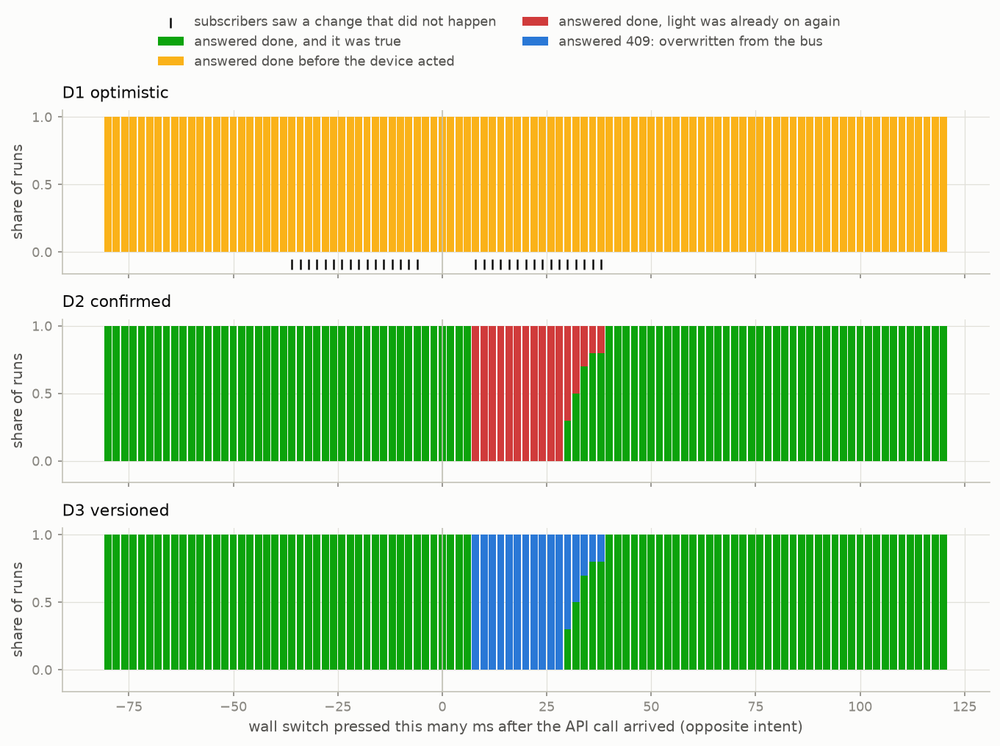
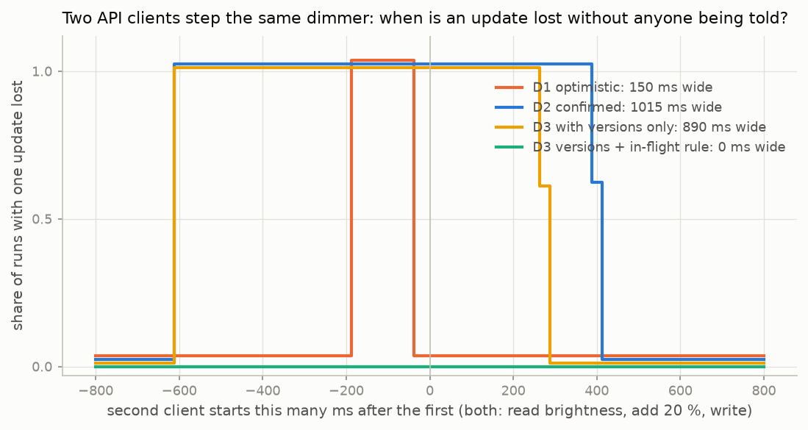
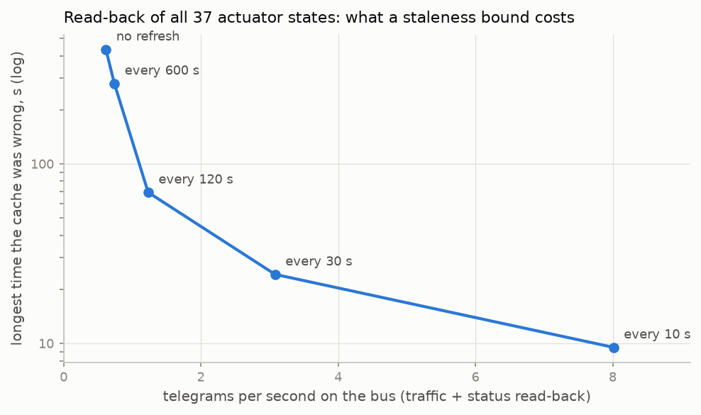
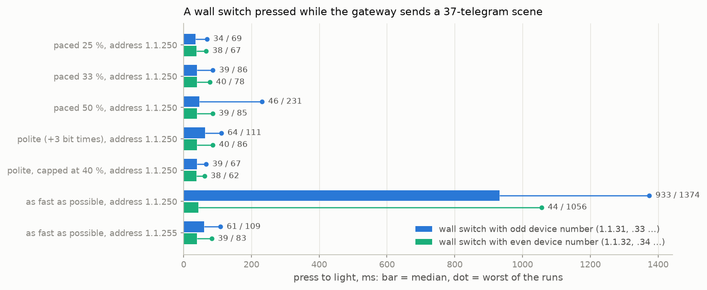
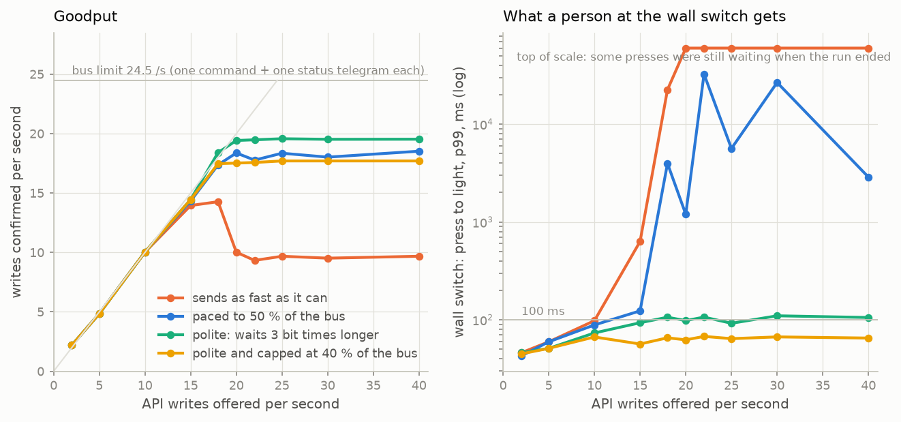

# Dossier: what a web API gateway on a KNX line can honestly guarantee

Everything in this dossier is simulated. There is no KNX hardware behind it and no measured
field data. The structure follows Wasson, *System Engineering Analysis, Design, and
Development*: need, modes, requirements, architecture, budgets, trade study, model and its
validation, FMEA, verification. Sources S1 to S8 are listed in [docs/SOURCES.md](docs/SOURCES.md).
All result tables are written by `scripts/make_tables.py` from `results/summary.json`.

## 1. Need and operational concept

A building has a KNX twisted-pair line with wall switches, actuators and sensors. It works
without any server. A gateway is added so that phone apps, voice assistants and cloud
integrations can read and control the installation through a web API, here a subset of the
KNX IoT 3rd Party API (S1).

The gateway does not own the state. A person at a wall switch changes a light without asking
it. The gateway is one more station on a shared 9600 bit/s bus, it hears what the others send,
and it has to tell its clients something about a state it can only infer.

Actors and what they need:

| Actor | Needs |
|---|---|
| Person at the wall switch | The light reacts at once, whatever the cloud is doing. |
| App user | Sees the real state; a tap does what the screen suggested. |
| Voice assistant, automation | A clear answer: done, not done, or not known yet. |
| Integrator who writes the client | Knows what a `204` means and how old a value is. |
| Installer, owner | A stolen token or a broken integration cannot open every blind or wear out relays. |

The question: **when a web API and the bus can both change the same light at the same moment,
what can the gateway honestly guarantee about state, ordering and latency, and what does each
guarantee cost?**

## 2. Modes and states

Gateway: `starting` (cache empty, every status has to be read once) -> `running` ->
`overloaded` (command queue full, new writes get `429` with `Retry-After`) -> `running`.
`degraded` is entered per datapoint when the bus gives no acknowledge or no status.

One API write goes through these states in the core (`knxgw/gateway/core.py`, class `Op`):

```
            refuse: 409 version / 429 rate, queue          withdraw: 409 (state moved)
               ^                                               ^
 request --> admitted --> queued --> handed to the bus --> on the wire --> L_Data.con
                                                                              | not ok -> 504
                                                                              v
                                              await status telegram --> confirmed -> 204
                                                       |    |
                                 no status in 400 ms   |    +--> other command heard meanwhile -> 409
                                 (+ travel time) -> 504
```

The optimistic design answers `204` at "admitted". The other two answer at "confirmed" for
datapoints that react at once, and `202` at "admitted" for datapoints that travel (dimmer
value, blind position), as the specification allows ("Accepted, but not processed yet", S1).

## 3. Requirements

| ID | Requirement | Source | Verified by |
|---|---|---|---|
| R1 | The API shape (paths, status codes, JSON:API documents) of the implemented subset matches the published description. | S1 | Contract tests against the official JSON schemas, `tests/test_api_contract.py` |
| R2 | A value outside the datapoint type (range, enumeration, format) is refused with `422` and never reaches the bus. | S1 (`updateDatapoints`), S5 5.13-1 | `test_security.py::test_fuzzed_values_are_refused_before_the_bus` |
| R3 | A success answer to a write is not derived from the link-layer confirm alone: `L_Data.con` only says that some group member acknowledged. | S4 | `test_scenarios.py::test_a5_silent_loss_*` |
| R4 | Every value carries the time of its last confirmation by the bus and a version. | this study | `test_core.py::test_freshness_*`, `test_api_contract.py::test_every_datapoint_*` |
| R5 | Reads never cause bus traffic. | bus capacity, section 5 | `test_scenarios.py::test_polling_served_from_the_cache_*` |
| R6 | While the API is overloaded, a wall switch still switches its light within 100 ms (p99). | S7 | `results/summary.json` `rate_sweep`, `scene_burst` |
| R7 | Offered load above bus capacity is refused with `429` and `Retry-After`; the queue is bounded. | S1 (`429`), section 5 | `test_core.py::test_queue_bound_and_retry_after` |
| R8 | One client cannot take the capacity of the others. | this study | `test_scenarios.py::test_fair_queue_needs_a_per_client_limit_*` |
| R9 | Scopes `read`, `write`, `manage` do not include each other; a token can be limited to a location. | S1, S6 (RFC 9700 section 2.3) | `test_security.py::test_scopes_*`, `test_location_scoped_*` |
| R10 | All functions except the version document need authentication. | S5 5.5-4, 5.5-5, 5.6-2 | `test_security.py::test_every_resource_needs_a_token` |
| R11 | Guessing a client secret over the network is impracticable. | S5 5.1-5 | `test_security.py::test_wrong_secret_locks_*` |
| R12 | No universal default credentials; secrets and tokens are stored as hashes. | S5 5.1-1, 5.4-1, 5.4-3 | `test_security.py::test_secrets_and_tokens_are_not_stored_*` |
| R13 | Security-relevant events are recorded and can be examined. | S5 5.10-1 | `test_security.py::test_every_write_and_every_denial_*`, `test_audit_log_detects_*` |
| R14 | Transport security (TLS) is used. | S1, S5 5.5-1 | **Not met in this repository.** The demo serves plain HTTP on the loopback interface. See section 12. |

## 4. Architecture and interfaces

```
 apps, voice, cloud                     gateway process                               TP1 line (simulated)
 ------------------      ------------------------------------------------      ---------------------------
  HTTPS  GET/PUT   -->   api.py      auth.py (OAuth 2.0, scopes, locations)
  WebSocket        <--    |          audit.py (hash-chained log)
  HTTP callbacks   <--    |          notify.py (signed callbacks, WebSocket fan-out)
                          v
                         core.py     state cache: value, version, confirmed_at, source, pending
                          |          command queue: 3 classes, round robin per client,
                          |                         token bucket per client, bounded
                          |          consistency design: optimistic | confirmed | versioned
                          v
                         bus driver (a Station): send(frame) / on_con(ok) / on_frame(any frame) <--> wall switches,
                                                                                                    actuators, sensors
```

Interfaces:

- **Client side:** the subset of the KNX IoT 3rd Party API 2.1.0 listed at the top of
  `knxgw/gateway/api.py`. Vendor additions live in JSON:API `meta` members with the prefix `gw:`
  (`gw:version`, `gw:confirmedAt`, `gw:ageMs`, `gw:source`, `gw:pending`, `gw:pendingTarget`,
  and `gw:ifVersion` on a write). Not implemented, and answered with `501`: devices,
  installations, sites, node, timeseries, datafields, proxies, certificate endpoints,
  authorization code grant, query filters, `PATCH` of subscriptions, node and installation
  subscriptions, reading and writing over the WebSocket.
- **Bus side:** group value write, read and response on a standard frame; the gateway hears every
  frame and acknowledges none that it only monitors (design decision D-3 in section 6.3).
- **Core:** `write(client, items, callback)` and `read(client, ids, callback)`. The HTTP layer
  and the simulated clients of the studies call the same two functions.

## 5. Performance budgets and margins

Bus timing, from S2 and S3:

<!-- TABLE:bus -->
| Quantity | Value |
|---|---|
| Bit time at 9600 bit/s | 104.2 us |
| Telegram with a 1-bit value (9 characters), incl. acknowledge and idle time | 20.42 ms |
| Telegram with a 1-byte value / 2-byte value | 21.77 / 23.12 ms |
| Shortest and longest telegram in the model (8 and 23 characters) | 18.75 to 39.38 ms (published: 20 to 40 ms) |
| Most 1-bit telegrams per second, formula / simulated back to back | 48.98 / 48.98 |
| Most confirmed writes per second (command + status telegram) | 24.5 |
<!-- /TABLE -->

Budget for one confirmed write to a switched light on an idle bus:

| Step | Time | Basis |
|---|---|---|
| HTTP handling in the gateway | about 1 ms | measured on the development laptop, table below |
| Command frame, 9 characters | 12.2 ms | 9 x 13 bit times (S2) |
| Actuator reaction | 8 to 20 ms | **assumption A2**; the acknowledge slot (2.7 ms) and the idle time (5.5 ms) pass meanwhile |
| Status frame, 9 characters | 12.2 ms | S2 |
| **Total** | **33 to 45 ms** | the median in mixed traffic is at the upper end, because some writes wait behind others (section 6.1) |

<!-- TABLE:http -->
| Request (FastAPI process, development laptop) | Handler time p50 / p95 (ms) |
|---|---|
| GET one datapoint | 0.57 / 0.95 |
| GET all 64 datapoints | 1.80 / 2.61 |
| PUT one value (optimistic design, no bus wait) | 0.93 / 1.39 |
<!-- /TABLE -->

The server is about one twentieth of one telegram. A faster server changes nothing.

Capacity: every confirmed write costs two telegrams, so the bus carries at most 24.5 of them
per second, before any other traffic. The command queue holds 64 commands; at the measured
throughput that is a wait of about 3.5 s before `429` starts (answer time p50 at overload in
section 6.3). A shorter queue gives a shorter worst case and earlier refusals; this is a
setting, not a result.

Margin against R6 (100 ms at the wall switch): see section 6.3. With the bus access chosen
there the requirement holds at any offered load; with the naive one it is missed by more than
a factor of ten.

## 6. Trade studies

### 6.1 Consistency design

Three alternatives, all with the same bus access (section 6.3) and the same traffic:

- **D1 optimistic.** The cache takes a written value at once and follows whatever it hears on
  the bus, commands and status alike. The call returns at once.
- **D2 confirmed.** The cache changes only when the device reports a state on its status
  address. The call returns when that report has been heard (switches) or with `202`.
- **D3 versioned.** D2 plus: a version per datapoint, conditional writes, a writer reads its
  own writes, a pending marker with the target for datapoints that travel, a `409` when
  another bus command was heard between the gateway's telegram and its status, and a second
  look at every item of a batch before the batch is answered.

**Decision rule.** Gates first, cost second. G1: no success answer for a value the device did
not take. G2: subscribers are told exactly the changes that happened. G3: no update lost
between two API clients without one of them being told. Among the designs that pass all
gates, take the one with the lowest answer time.

Controlled races (`race_scan`, `rmw_scan`; one light or one dimmer, the second actor shifted in
steps of 2 ms and 25 ms):

<!-- TABLE:scan -->
| | D1 optimistic | D2 confirmed | D3 versioned |
|---|---|---|---|
| Answered 'done' before the device acted | 100 % | 0 % | 0 % |
| Wall-press offsets with a false 'done' | none | 8 to 38 ms | none |
| Width of that window, weighted by probability | 0 ms | 26 ms | 0 ms |
| Same offsets answered 409 instead | 0 ms | 0 ms | 26 ms |
| Offsets where subscribers saw a change that did not happen | -36 to 38 ms | none | none |
| Two API clients step one dimmer: window in which an update is lost silently | 150 ms | 1015 ms | 0 ms |
| D3 with versions but without the in-flight rule | | | 890 ms |
<!-- /TABLE -->





Mixed traffic, "office" profile (a busy working hour, assumption A6):

<!-- TABLE:designs_office -->
| | D1 optimistic | D2 confirmed | D3 versioned |
|---|---|---|---|
| API writes in the run | 13536 | 13536 | 13536 |
| Answer time for switch writes, p50 / p95 / p99 (ms, at the gateway) | 2 / 2 / 2 | 45 / 228 / 241 | 45 / 228 / 241 |
| Light really switches after, p50 (ms) | 30 | 30 | 30 |
| Dimmer value / blind position confirmed after, p50 (s) | 0.4 / 15.1 | 0.4 / 15.1 | 0.4 / 15.1 |
| Values answered 'done' before the device had acted | 16229 of 16260 | 0 of 11475 | 0 of 11475 |
| Answered 'done', own telegram was never executed (switches only) | 1 | 0 | 0 |
| Answered 'done', device was already in another state | 0 | 1 | 0 |
| Answered 409 conflict | 0 | 0 | 24 |
| Answered 504, although the device did switch | 0 | 2 | 0 |
| Toggles and steps computed from a state that was no longer true, nobody told / told | 2 / 0 of 7861 | 1 / 0 of 7862 | 0 / 0 of 7862 |
| Changes told to subscribers that never happened / real changes not told | 51 / 1 of 44439 | 0 / 6 of 44439 | 0 / 4 of 44439 |
| Read straight after own write returns a value the device does not have (switch / moving datapoint) | 62.7 % / 99.5 % | 0.0 % / 0.0 % | 0.0 % / 0.1 % |
| Read straight after own accepted write does not show the write and does not say so (moving datapoint) | 0 % | 100 % | 0 % |
| Share of time the cache differs from the device (switches / moving datapoints) | 0.008 % / 1.04 % | 0.034 % / 0.00 % | 0.005 % / 0.01 % |
| Longest time the cache was wrong about a switch (s) | 205.1 | 1597.9 | 0.1 |
| Wall switch, press to light, p99 (ms) | 32 | 32 | 33 |
| Bus load (share of time a frame is on the wire) | 1.0 % | 1.0 % | 1.0 % |
<!-- /TABLE -->

Mixed traffic, "contended" profile (stress: three app users, and 30 % of all wall presses
coincide within 150 ms with a tap on the same light in an app):

<!-- TABLE:designs_contended -->
| | D1 optimistic | D2 confirmed | D3 versioned |
|---|---|---|---|
| API writes in the run | 37411 | 37391 | 37221 |
| Answer time for switch writes, p50 / p95 / p99 (ms, at the gateway) | 2 / 2 / 2 | 45 / 104 / 236 | 44 / 93 / 238 |
| Light really switches after, p50 (ms) | 30 | 30 | 29 |
| Dimmer value / blind position confirmed after, p50 (s) | 0.4 / 15.1 | 0.4 / 15.1 | 0.4 / 15.1 |
| Values answered 'done' before the device had acted | 40688 of 40966 | 0 of 31362 | 0 of 29086 |
| Answered 'done', own telegram was never executed (switches only) | 3 | 1 | 1 |
| Answered 'done', device was already in another state | 0 | 71 | 0 |
| Answered 409 conflict | 0 | 0 | 2281 |
| Answered 504, although the device did switch | 0 | 4 | 1 |
| Toggles and steps computed from a state that was no longer true, nobody told / told | 908 / 0 of 26633 | 1997 / 0 of 26641 | 2 / 0 of 26423 |
| Changes told to subscribers that never happened / real changes not told | 2117 / 11 of 97325 | 0 / 14 of 95782 | 0 / 14 of 95575 |
| Read straight after own write returns a value the device does not have (switch / moving datapoint) | 80.7 % / 98.7 % | 0.2 % / 0.0 % | 0.0 % / 0.0 % |
| Read straight after own accepted write does not show the write and does not say so (moving datapoint) | 0 % | 100 % | 0 % |
| Share of time the cache differs from the device (switches / moving datapoints) | 0.059 % / 4.13 % | 0.051 % / 0.03 % | 0.060 % / 0.02 % |
| Longest time the cache was wrong about a switch (s) | 56.4 | 37.5 | 121.9 |
| Wall switch, press to light, p99 (ms) | 50 | 51 | 51 |
| Bus load (share of time a frame is on the wire) | 2.8 % | 2.8 % | 2.8 % |
<!-- /TABLE -->

**Result.** D1 fails G1 and G2. D2 fails G1 in a window of a few tens of milliseconds after its
own telegram, and for the early items of a batch (a batch is answered when its last item is
confirmed, so the answer is as old as its first item), and it fails G3 badly. D3 passes all
three in these runs. D3 is chosen. Its price
is in the same tables: the answer to a switch write comes after two telegrams instead of
after the handler time, travelling datapoints are answered `202`, and clients have to handle
`409`.

Two things in these tables were not what I expected:

1. For two API clients, D2 is *worse* than D1. D1's cache is the one place where API clients
   meet, and it shows the first client's write to the second at once. D2's cache keeps the old
   value until the dimmer has finished its ramp, so the second client computes from a stale base
   for the whole ramp. Versions alone do not repair that, because the version only moves when
   the status arrives. A conditional write has to be refused while another write, or a command
   heard from the bus, is still on its way (`cond_blocks_on_pending`, `_foreign_open`).
2. When frames get lost, D1 misses fewer real changes than D2 and D3 (last but one column of
   the table in section 6.2): it also follows the command telegram, so it has two chances to
   hear a change. The price is that it believes commands that were never executed.

### 6.2 What stays wrong with the strictest design

D3 still has one anomaly, and no API design removes it. The gateway is one listener on a
broadcast bus that has no sequence numbers. If the gateway alone misses a status telegram that
another group member acknowledged, nothing tells it that something is missing. Two effects:
the write is answered `504` although the light did switch (row "Answered 504, although the
device did switch"), and the cache is wrong until the next change of that datapoint. The
size depends only on how often that happens, which I do not know (assumption A4; "contended"
traffic, short runs, so the counts are small):

<!-- TABLE:loss -->
| Chance that one station misses one frame | D1: 'done' but never applied | D2: 504 although applied | D3: 504 although applied | D2 longest wrong cache (s) | D3 longest wrong cache (s) | Real changes not told, D1 / D2 / D3 | Repetitions per 1000 telegrams |
|---|---|---|---|---|---|---|---|
| 0 | 0 of 5667 | 0 | 0 | 0 | 0 | 1 / 0 / 0 | 1.0 |
| 0.0001 | 0 of 5667 | 4 | 0 | 0 | 0 | 1 / 0 / 0 | 1.0 |
| 0.001 | 2 of 5667 | 8 | 5 | 128 | 232 | 8 / 19 / 21 | 1.5 |
| 0.01 | 44 of 5667 | 101 | 68 | 204 | 167 | 58 / 159 / 194 | 6.5 |
<!-- /TABLE -->

The only bound is to read every status back in a cycle. That costs bus capacity ("office"
traffic, miss probability raised to 1e-3 so that the effect shows in a short run):

<!-- TABLE:refresh -->
| Read-back of every actuator status | Telegrams/s on the bus | Longest wrong cache (s) | Share of time wrong | Wall switch p99 (ms) |
|---|---|---|---|---|
| none | 0.62 | 434.0 | 0.063 % | 32 |
| every 600 s | 0.74 | 280.3 | 0.049 % | 35 |
| every 120 s | 1.23 | 69.4 | 0.015 % | 43 |
| every 30 s | 3.08 | 24.2 | 0.008 % | 57 |
| every 10 s | 8.01 | 9.5 | 0.008 % | 64 |
<!-- /TABLE -->



The second thing that stays is not an anomaly but has to be printed: a confirmed answer is a
statement about the past. It says the device reported the state at one moment. The next wall
press is not blocked by it.

### 6.3 Bus access of the gateway

Alternatives: send as fast as the bus allows; pace to a share of the bus; choose an individual
address that loses arbitration; "polite": wait 3 bit times longer than the 53 that other
stations wait, so the gateway never enters an arbitration at all; polite and capped (after
each of its frames the gateway leaves the bus alone for 1.5 telegram times). Decision rule: R6 first
(wall switch p99 below 100 ms), then no false failures, then scene duration.

A scene for the whole floor in one API call (37 telegrams), one wall press during it:

<!-- TABLE:burst -->
| Bus access of the gateway | Scene done, median (ms) | Wall switch, odd device number, median / worst (ms) | even device number, median / worst (ms) | Writes reported failed although they worked |
|---|---|---|---|---|
| Paced to 25 %, 1.1.250 | 1422 | 34 / 69 | 38 / 67 | 0 in 90 runs |
| Paced to 33 %, 1.1.250 | 1174 | 39 / 86 | 40 / 78 | 0 in 90 runs |
| Paced to 50 % of the bus, 1.1.250 | 1062 | 46 / 231 | 39 / 85 | 0 in 90 runs |
| Polite (waits 3 bit times longer), 1.1.250 | 1012 | 64 / 111 | 40 / 86 | 0 in 90 runs |
| Polite and capped at 40 % of the bus, 1.1.250 | 1123 | 39 / 67 | 38 / 62 | 0 in 90 runs |
| As fast as possible, gateway at 1.1.250 | 995 | 933 / 1374 | 44 / 1056 | 1170 in 90 runs |
| As fast as possible, gateway at 1.1.255 | 1006 | 61 / 109 | 39 / 83 | 0 in 90 runs |
<!-- /TABLE -->



A steady stream of switch writes, one wall press per second:

<!-- TABLE:sweep -->
Each cell: writes confirmed per second, answer time p50 (ms), wall switch press to light p99 (ms).

| Offered writes/s | As fast as possible | Paced 50 % | Polite | Polite, capped 40 % |
|---|---|---|---|---|
| 2 | 2.2, 56, 46 | 2.2, 57, 43 | 2.2, 56, 46 | 2.2, 57, 45 |
| 5 | 4.8, 59, 60 | 4.8, 60, 60 | 4.8, 59, 51 | 4.8, 60, 51 |
| 10 | 10.0, 75, 98 | 10.0, 77, 88 | 10.0, 76, 73 | 10.0, 81, 67 |
| 15 | 13.9, 98, 632 | 14.3, 119, 123 | 14.4, 112, 93 | 14.4, 153, 56 |
| 18 | 14.3, 168, 22537 | 17.4, 586, 3966 | 18.4, 568, 106 | 17.5, 2236, 65 |
| 20 | 10.0, 424, 15 of 60 presses never served | 18.4, 3182, 1200 | 19.4, 3207, 98 | 17.5, 3642, 62 |
| 22 | 9.3, 430, 13 of 60 presses never served | 17.8, 3304, 32516 | 19.5, 2999, 106 | 17.6, 3433, 68 |
| 25 | 9.7, 447, 35 of 60 presses never served | 18.4, 3379, 5643 | 19.6, 3103, 92 | 17.7, 3441, 64 |
| 30 | 9.5, 1402, 35 of 60 presses never served | 18.0, 3348, 26687 | 19.5, 3374, 110 | 17.7, 3743, 67 |
| 40 | 9.7, 2422, 35 of 60 presses never served | 18.5, 3662, 2874 | 19.5, 3110, 106 | 17.7, 3919, 65 |
<!-- /TABLE -->



**Result.** The polite access with a cap at 40 % of the bus is chosen (D-1). Polite alone keeps
the full throughput but leaves the wall switch at about 100 ms p99 at saturation, because the
press then waits behind status telegrams; the cap gives up roughly a tenth of the throughput
and brings the wall switch clearly under 100 ms at any offered load (last column). Findings:

- Sent as fast as possible from 1.1.250, a scene makes some wall switches wait for the whole
  burst and others not. Which ones is decided by the bit pattern of their address: bits go out
  least significant first (S2), so 1.1.250 (binary ...010) beats every odd device number at the
  first bit. The usual advice to give the gateway a high address does not help; only 1.1.255
  loses against everybody.
- The same gateway also starves the status telegrams it is waiting for. It reports writes as
  failed that worked, and its goodput peaks near 14 writes per second and then falls below 10
  while the offered load rises.
- Pacing to 50 % is not enough: the free slot after each command is taken by the status
  telegram of that command, and wall switches with an unlucky address still wait.
- The polite access costs nothing in throughput, because the status telegrams need that half of
  the bus anyway.

Polling and flooding clients (D-2: reads come from the cache, admission is per client):

<!-- TABLE:poll -->
| Poll period (s) | Reads served from | Bus telegrams/s asked for | Bus load | Reads dropped | App writes ok / refused | Poll answer p50 (ms) |
|---|---|---|---|---|---|---|
| 10 | cache | 0 | 8 % | 0 | 30 / 0 | 122 |
| 5 | cache | 0 | 8 % | 0 | 30 / 0 | 122 |
| 3 | cache | 0 | 8 % | 0 | 30 / 0 | 122 |
| 2 | cache | 0 | 8 % | 0 | 30 / 0 | 122 |
| 1.5 | cache | 0 | 8 % | 0 | 30 / 0 | 122 |
| 1 | cache | 0 | 8 % | 0 | 30 / 0 | 122 |
| 0.5 | cache | 0 | 8 % | 0 | 30 / 0 | 122 |
| 10 | bus (read-through) | 7 | 20 % | 0 | 30 / 0 | 2044 |
| 5 | bus (read-through) | 15 | 30 % | 0 | 30 / 0 | 2008 |
| 3 | bus (read-through) | 25 | 45 % | 0 | 30 / 0 | 2018 |
| 2 | bus (read-through) | 37 | 62 % | 0 | 30 / 0 | 2006 |
| 1.5 | bus (read-through) | 49 | 66 % | 127 | 14 / 16 | 3876 |
| 1 | bus (read-through) | 74 | 66 % | 535 | 13 / 17 | 3754 |
| 0.5 | bus (read-through) | 148 | 66 % | 1768 | 1 / 29 | 122 |
<!-- /TABLE -->

<!-- TABLE:flood -->
| Queue | Per-client limit | Normal app: writes ok of sent | its answer p50 / p95 (ms) | Flooder: ok / refused of sent | Wall switch p99 (ms) |
|---|---|---|---|---|---|
| first in, first out | none | 5 of 30 | 3980 / 4118 | 552 / 2448 of 3000 | 67 |
| round robin | none | 2 of 30 | 163 / 186 | 546 / 2454 of 3000 | 70 |
| round robin | 10 writes/s | 30 of 30 | 85 / 186 | 339 / 2661 of 3000 | 61 |
<!-- /TABLE -->

A round-robin queue alone does not protect the normal app: the flooder fills the shared queue
and the app's request is refused at the door. The per-client token bucket is what protects it.

D-3: the gateway does not acknowledge frames it only monitors. If it did, a sender would get
an acknowledge although its actuator missed the frame, and the link-layer repetition, which
repairs most losses, would never start. The cost: for a group address on which the gateway
is the only listener, every frame is sent four times. In this installation a visualisation
panel listens to all status and sensor addresses.

## 7. The model and how far it can be trusted

Assumptions (everything else has a source in section 5 or in `docs/SOURCES.md`):

| ID | Assumption | Value | Sensitivity |
|---|---|---|---|
| A1 | Request handling time in the gateway, inside the simulation | 2 ms | measured about 1 ms; negligible either way |
| A2 | Actuator reaction, frame received to output switched | uniform 8 to 20 ms | table below |
| A3 | Dimmer ramps 0 to 100 % in 2 s and reports at the end; blind travels 30 s and reports at the end; status objects send after every write | fixed | not varied; see section 12 |
| A4 | A station misses a frame with probability 1e-4, independent per station and frame; a frame is damaged for all with 1e-3 | per frame | section 6.2, four decades |
| A5 | Client network delay one way: 5 ms on the LAN, 60 ms from a cloud | fixed | sets the D1 lost-update window (section 6.1) |
| A6 | Traffic profiles, mean time between events per room: wall press on the light every 10 min ("office") or 1 min ("contended") and so on, see `PROFILES` in `knxgw/study/consistency.py` | Poisson | two profiles; rates of rare races scale with these numbers |
| A7 | The gateway hands a frame to the bus in zero time and can withdraw it until the first bit | idealised | section 12 |

<!-- TABLE:react -->
| Actuator reaction time (assumed range, ms) | Confirmed answer p50 / p95 (ms) |
|---|---|
| 2 to 5 | 35 / 106 |
| 8 to 20 | 45 / 103 |
| 30 to 60 | 80 / 129 |
<!-- /TABLE -->

How do we know the model is right:

- **Published figure.** The model's shortest and longest telegram bracket the "20 ms to 40 ms"
  of the KNX training material (S2), and the formula is the one printed there (table in
  section 5, `tests/test_bus.py::test_telegram_duration_matches_published_20_to_40_ms`).
- **Analytic check.** 500 telegrams back to back in the simulator give the same telegrams per
  second as the formula, to four decimals (`model_validation` in `summary.json`).
- **Internal consistency of the source.** The priority coding in S2 (00 system, 10 alarm,
  01 high, 11 low) is a ranking only if D2 is sent before D3, that is least significant bit
  first. The same document says so in words. The arbitration order of the model follows from
  that and nothing else.
- **Limiting cases.** No acknowledging station: 4 transmissions, negative confirm. Damaged
  acknowledge: sender repeats, receiver passes the frame up once. No loss: no repetition
  (`tests/test_bus.py`).
- **Reproducibility.** Same seed, same numbers
  (`tests/test_scenarios.py::test_mixed_traffic_run_is_reproducible`).

What the model cannot tell: whether real devices start a waiting frame in exactly the same bit,
how often frames are really lost, and how a real transceiver behaves between hand-over and
first bit. Those need a bus monitor on a real line.

## 8. FMEA of the gateway design

| # | Failure mode | Effect | Detection | Mitigation in the design | Left open |
|---|---|---|---|---|---|
| 1 | Actuator misses a command that another group member acknowledged | Light does not switch, bus reports success | D2 / D3: no status within 400 ms -> `504` | Feedback required for success (R3) | D1 cannot detect it |
| 2 | Gateway alone misses a status telegram | False `504`, cache wrong | None | Cyclic read-back (off by default), freshness shown to clients | Cost in bus load, section 6.2 |
| 3 | Gateway floods the bus | Wall switches delayed, own feedback starved | Queue length, feedback time-outs | Polite access, bounded queue, per-client limit | - |
| 4 | Client writes one datapoint many times per second | Relay wear, flicker | Audit log | Minimum interval per datapoint (`dp_min_interval_ms`, off by default) | Sensible default per device type |
| 5 | Status arrives for an older command | D1 shows a change that did not happen | - | D2 / D3 follow status only and match it after their own confirm | - |
| 6 | Wall command in flight when a conditional write arrives | Lost update | Command heard on the bus | Conditional write refused until the status came, limited to the feedback time-out so a deaf actuator cannot block it for ever | - |
| 7 | Gateway restarts | Cache empty | - | All statuses must be read: 37 reads + 37 responses, about 1.5 s of bus time | The simulation starts with a correct cache; start-up is not simulated |
| 8 | Slow WebSocket client or dead callback endpoint | Memory growth | Queue length | Bounded queues, newest value per datapoint kept | Retry policy for callbacks |
| 9 | Token stolen | Attacker controls what the token allows | Failed-auth counters, audit log | Section 9 | - |
| 10 | Actuator sends status only on change | A write of the present value gets no status -> false `504` in D2 / D3 | - | None yet | Not simulated as a study, see section 12 |

## 9. Security analysis

Assets: the ability to switch loads and move blinds; knowledge of presence in rooms; the
availability of the bus. Baseline used for orientation: ETSI EN 303 645 V2.1.1 (S5). This is a
mapping of controls to provisions, not an assessment against the standard.

| Threat | Control implemented | EN 303 645 | Test (`tests/test_security.py`) |
|---|---|---|---|
| T1 Request without or with a guessed token | Every resource needs a bearer token; only `/.well-known/knx` is open and it gives the API version only; no documentation or demo routes outside demo mode | 5.5-4, 5.5-5, 5.6-1, 5.6-2 | `test_every_resource_needs_a_token`, `test_only_the_version_document_*` |
| T2 Over-broad scope | `read`, `write`, `manage` separate; token limited to a location subtree with the vendor scope `loc:<id>`; a client can never get more than it was registered for; a batch with one datapoint outside the scope sends nothing | 5.6-7 (least privilege, by analogy) | `test_scopes_*`, `test_location_scoped_*`, `test_batch_with_one_datapoint_outside_*`, `test_blast_radius_*` |
| T3 Token theft | Access tokens live 15 minutes at most; refresh tokens rotate and a second use revokes the family; a client can be disabled at once, which also ends its WebSocket stream; only hashes are stored | 5.4-1, 5.5-7 | `test_access_token_expires`, `test_refresh_token_rotates_*`, `test_disabling_a_client_*`, `test_secrets_and_tokens_*` |
| T4 Guessing the client secret | Secrets are 256 random bits, generated per client and shown once; 5 failures lock the client for 60 s, doubling each time; the same work is done for unknown clients | 5.1-1, 5.1-5, 5.4-3 | `test_wrong_secret_locks_*`, `test_each_provisioned_client_*` |
| T5 Compromised cloud integration | Location scope limits what it can reach (37 writable datapoints for the floor, 4 for one room); per-client write rate; optional minimum interval per datapoint; every write and denial in a hash-chained audit log; kill switch | 5.10-1 | `test_write_rate_limit_*`, `test_every_write_and_every_denial_*`, `test_audit_log_detects_*` |
| T6 Replay | A captured request stops working when the token expires; a conditional write cannot be repeated; callbacks are signed as the specification says, and the receiver helper also refuses a `Date` older than 2 minutes, which the specification does not ask for | 5.5-1 | `test_a_captured_request_*`, `test_conditional_write_cannot_be_replayed`, `test_callback_signature_and_replay_window` |
| T7 Callback used to reach the home network | Callback URL must be `https` and its host must be on the list registered for the client; subscriptions are private to their client and limited to the token's locations | 5.6-1 | `test_callback_url_must_be_https_*`, `test_subscription_cannot_reach_*`, `test_subscriptions_are_private_*` |
| T8 Malformed input | Strict parsing: ASCII decimals only, range, enumeration, UUID, body size; nothing is sent on a refused request | 5.13-1 | `test_fuzzed_values_are_refused_before_the_bus`, `test_non_string_json_values_are_refused` |

Not covered: TLS (R14), secure storage of the audit log outside the device, software update,
vulnerability disclosure (EN 303 645 5.2, 5.3), and KNX Data Secure on the bus side. A token
taken from a client that is still enrolled works until it expires or the client is disabled;
sender-constrained tokens (S6) would close that and are not implemented.

## 10. Verification and validation

| Level | What | Where | Result |
|---|---|---|---|
| Unit | Bus timing, arbitration, repetition, loss, datapoint types | `tests/test_bus.py` | pass |
| Unit | Cache, versions, queue, token bucket, three designs | `tests/test_core.py` | pass |
| Contract | Responses and my requests against the official JSON schemas; every used path, method and status code exists in the OpenAPI file | `tests/test_api_contract.py` | pass |
| Behaviour | The designs seen through HTTP | `tests/test_api_behaviour.py` | pass |
| Scenario | One deterministic scenario per anomaly A1 to A5, overload cases, reproducibility | `tests/test_scenarios.py` | pass |
| Security | Section 9 | `tests/test_security.py` | pass |
| Study | Sections 5 to 7 | `scripts/run_all.py` -> `results/` | tables above |
| Demonstration | Web client against the running gateway | `scripts/take_screenshots.py` -> `docs/img/` | screenshots |

159 tests, run with `python -m pytest -q`. Requirements R1 to R13 are met in the simulation;
R14 is not met.

## 11. What the API documentation could honestly print

**D1 optimistic.** "`204`: the command was accepted and queued for the bus. `GET` returns the
last value written through the API or heard on the bus, whichever is later. Neither says what
the device did. `gw:confirmedAt` is the last time the device reported this value."

**D2 confirmed.** "`204`: after our telegram, the device reported the requested state. It may
have been changed again by the time you read this. `202`: accepted, the device is moving;
watch the notifications. `504`: no report within 400 ms; the device may still have switched.
`GET` returns the last state the device reported; `gw:confirmedAt` says when."

**D3 versioned.** As D2, plus: "With `gw:ifVersion` the telegram is sent only if no change of
this datapoint, no other write and no bus command for it was seen up to the moment of sending;
otherwise `409` and nothing is sent. `409` after sending: your value was applied and another
bus command followed. After your own write you read your own write, or a pending marker with
its target. A status telegram that the gateway misses makes the value wrong until the next
change; `gw:ageMs` is the only warning."

No design can print "the light is on".

## 12. Limits

- No hardware. Loss rates, press rates and actuator timing are assumptions. The rates of rare
  races are those assumptions multiplied by window widths; the window widths are the result.
- The polite access and the withdrawal of a frame at the last moment assume a transceiver that
  the host can time to a few bit times. With a UART-type transceiver the frame is handed over
  earlier; the window in which a conditional write can still be overtaken then grows by that
  hand-over time. Not modelled.
- One line, no couplers, no BUSY, no extended frames, no KNX Data Secure.
- Actuators report after every write. With "report on change" a write of the present value
  gets no status and D2 / D3 would answer `504` (FMEA 10). Not studied.
- Start-up is idealised (FMEA 7).
- TLS is not set up (R14). The authorization code grant is not implemented.
- The specification document 3/10/4 itself was not available to me; the subset follows the
  public OpenAPI file only. No conformance is claimed and none was tested.
