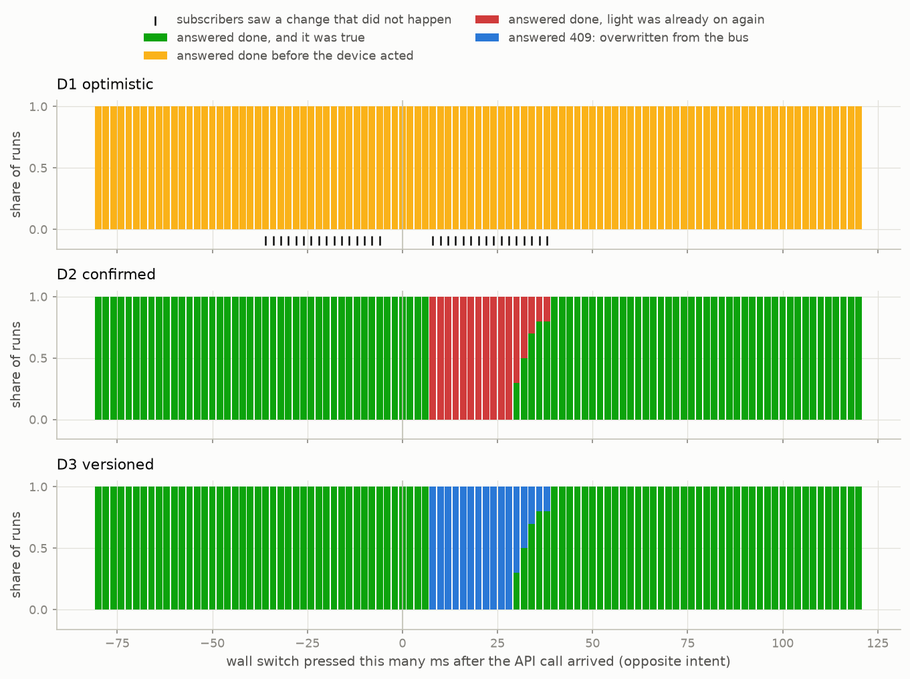
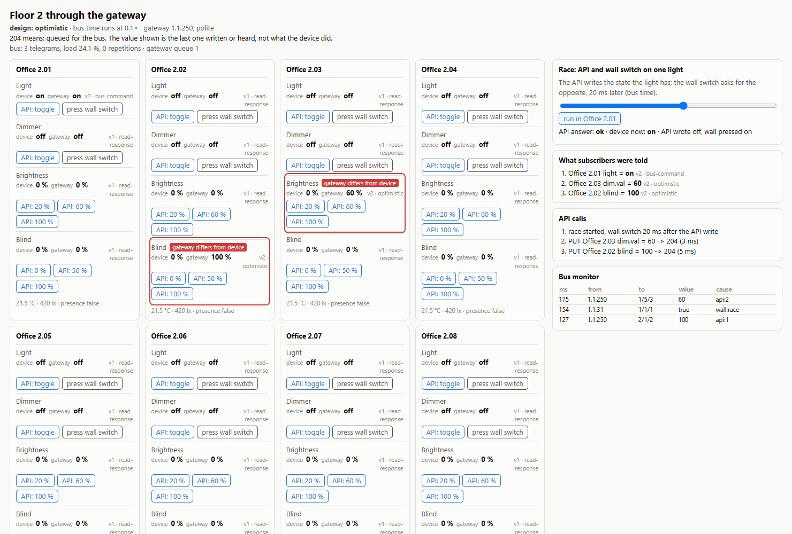
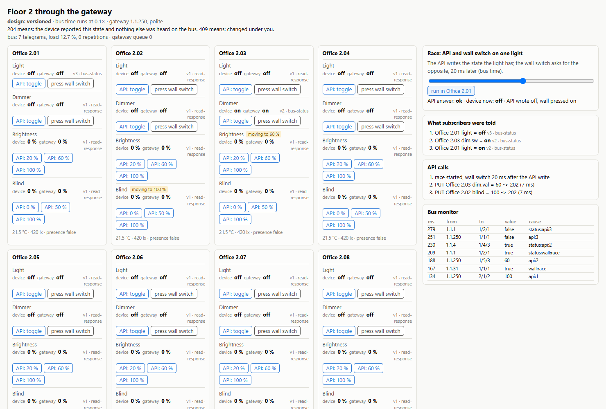

# KNX IoT API gateway: what can it honestly tell a client about a light?

**Simulated study, no hardware.** The KNX line, the devices, the people at the wall switches
and the API clients are simulated. The gateway code and its HTTP API are real and run. No
number here was measured on a KNX installation, and no conformance to the KNX IoT 3rd Party
API is claimed.

## The question

A gateway exposes a KNX installation to apps and voice assistants through a web API. A person
at a wall switch and an API client can change the same light at the same moment. What can the
gateway honestly guarantee to its clients about state, ordering and latency, and what does
each guarantee cost?

Three designs are compared on the same simulated floor (9 rooms, 64 datapoints, one TP1 line):
**D1 optimistic** (the cache takes a written value at once), **D2 confirmed** (the cache changes
only when the device reports), **D3 versioned** (D2 plus a version per datapoint, conditional
writes, read-your-writes and a pending marker).

## The answer

1. **The bus sets latency and throughput, the server does not.** A telegram with a 1-bit value takes
   20.4 ms with its acknowledge and idle time, so the line carries at most 49.0 telegrams per
   second. The HTTP handler of the real gateway needs about 0.9 ms (measured). A confirmed write to
   a light is answered after 45 ms (median): command telegram, actuator reaction, status telegram.
   Every confirmed write costs two telegrams, so the ceiling is 24.5 writes per second; with the
   other traffic of the floor the gateway reaches 19.5, and 17.7 with the bus access that keeps wall
   switches fast.

2. **What a "confirmed" answer costs, and what the fast one hides.** D1 answers in 2 ms, and in the
   controlled race it had answered before the device did anything in 100 % of the runs. Under stress
   traffic 80.7 % of its read-backs straight after a switch write returned a state the light did not
   have, subscribers were told 2117 changes that never happened (2.2 % of the real ones), and for
   dimmer values and blinds its cache was wrong 4.1 % of the time. D2 and D3 pay 45 ms for a light,
   0.4 s (median) for a dimmer value and 15 s (median, 30 s at p95) for a blind. No HTTP call can
   wait for a blind, so those writes are answered `202` and confirmed by a notification.

3. **One anomaly remains with the strictest design.** D2 answers "done" although the light is
   already in another state when a wall press falls 8 to 38 ms after the API call, or when an early
   item of a batch is changed before the batch is answered (71 of 31362 answers under stress
   traffic); D3 answers `409` in those cases (0 of 29086). What D3 cannot repair is a status
   telegram that only the gateway misses: the bus has no sequence numbers, so nothing tells the
   gateway. It then answers `504` although the light switched, and its cache stays wrong until that
   datapoint changes again (with a miss probability of 1e-3 per frame: 5 such answers and up to 232
   s in a short run). The only bound is to read every status back: every 30 s costs 2.5 telegrams
   per second more and cuts the longest wrong value from 434 s to 24 s in the quiet profile.

4. **A cache that follows only confirmed states makes two API clients worse, not better.** Two
   clients each add 20 % to one dimmer. One update is lost without anyone being told if they start
   within 150 ms of each other in D1 (the network round trip of the slower client), within 1015 ms
   in D2 (its cache keeps the old value until the dimmer has finished its ramp), and still within
   890 ms with versions alone. The window is 0 ms only when a conditional write is also refused
   while another write or a bus command for that datapoint is on its way. The same shows under
   stress traffic: 1997 toggles computed from a state that was no longer true in D2, 908 in D1, 2 in
   D3.

5. **Under overload, what protects the wall switch is how the gateway takes the bus.** A scene of 37
   telegrams sent as fast as possible from address 1.1.250 delays a wall switch by 655 ms (median,
   1.4 s worst), and which switches are hit depends on the bit pattern of their address (933 ms for
   odd device numbers, 44 ms for even ones: bits go out least significant first). The gateway also
   starves the status telegrams it is waiting for and reports writes as failed that worked (1170 in
   90 scenes); its confirmed throughput peaks at 14.3 writes per second and falls to 9.7 when more
   is offered. If the gateway waits 3 bit times longer than every other station and uses at most 40
   % of the bus, the same wall switch needs 38 ms (median) and 67 ms (worst) during the scene and
   stays below 68 ms (p99) at any offered load; the scene takes 1.12 s instead of 1.00 s. A fair
   queue alone does not protect a normal client from a flooding one (2 of 30 writes served); a
   per-client limit does (30 of 30).



*For every offset between an API write ("off") and a wall press ("on") on the same light: what
the API answered, and whether it was true at that moment. D1 always answers before the device
has done anything. D2 has a window in which it answers "done" although the light is already on
again. D3 answers 409 in exactly that window.*

Other figures:

- `results/fig2_latency_cdf.png`: when the API answers and when the light really switches. The
  handler time of the server is the thin line on the left; everything else is bus time.
- `results/fig3_overload.png`: confirmed writes per second and wall-switch delay against offered
  API load, for four ways of sharing the bus.
- `results/fig4_scene_burst.png`: how long a wall switch waits while the gateway sends a scene,
  split by odd and even device number.
- `results/fig5_lost_update_window.png`: two API clients step one dimmer; for which time offsets
  one update is lost without anyone being told.
- `results/fig6_refresh_trade.png`: cyclic read-back of all statuses, staleness bound against
  bus load.

The running web client (real screenshots, bus time slowed to 0.1x). Left: D1 shows a blind at
100 % and a dimmer at 60 % that have not moved, and has answered "ok" to a write that the wall
switch overrode. Right: D3 shows the same blind as "moving to 100 %".

| D1 optimistic, during a race | D3 versioned |
|---|---|
|  |  |

## How to run

```bash
pip install -r requirements.txt
python -m pytest -q                  # 159 tests
python scripts/run_all.py            # all studies -> results/summary.json and the figures
```

`python scripts/make_tables.py` writes the tables of this README and of the dossier from
`results/summary.json`. `python scripts/run_all.py --quick` is the short run used in CI.

The live gateway with the web client:

```bash
cd web && npm install && npm run build && cd ..
python -m knxgw.gateway.server --demo --design versioned --speed 0.2    # http://127.0.0.1:8080
```

Without `--demo` the server provisions one client, prints its credentials once and serves only
the API.

## What is modelled and what is not

Modelled:

- One TP1 line at telegram level: 9600 bit/s, 13 bit times per character, acknowledge slot, 50
  and 53 bit times of idle time, bit-by-bit arbitration in the order the bits go out, three
  repetitions, loss of a frame at a single station (`knxgw/bus/tp1.py`). The timing reproduces
  the published 20 to 40 ms per telegram.
- 44 bus devices: multi-channel switch, dimming and blind actuators with status objects, wall
  switches, presence detectors, cyclic temperature and brightness sensors, a visualisation panel.
- The gateway: bus driver, state cache with version and time of last bus confirmation, command
  queue with priority classes, round robin and per-client rate limit, three consistency designs
  (`knxgw/gateway/core.py`).
- A subset of the KNX IoT 3rd Party API 2.1.0 over HTTP: locations, functions, datapoints,
  `PUT /datapoints/values`, OAuth 2.0 client credentials and refresh grants with scopes
  `read` / `write` / `manage`, callback subscriptions with signed notifications, WebSocket
  notifications (`knxgw/gateway/api.py`). The list of what is implemented and what answers
  `501` is at the top of that file and in DOSSIER section 4.
- Security controls and a threat model with a mapping to ETSI EN 303 645 (DOSSIER section 9).

Not modelled or not done:

- Real devices. Frame loss rates, how often people press switches and how fast an actuator
  reacts are assumptions (DOSSIER section 7), each with a sensitivity run.
- Line couplers, BUSY flow control, extended frames, KNX Data Secure.
- TLS. The specification makes it mandatory; the demo serves plain HTTP on the loopback only.
- The authorization code grant, devices, timeseries and the other parts listed as `501`.
- Start-up of the gateway (reading all statuses once).

## Limits and what I would do next with real hardware

- **Check the arbitration result on a real line.** The finding about odd and even device numbers
  follows from the bit order in the KNX training material. I would put a bus monitor on a line,
  let two devices send back to back and see who wins.
- **Measure the two numbers the conclusions depend on:** how often a device misses a frame that
  another one acknowledged, and the reaction time of real actuators. A week of bus monitor
  recording on a live floor would give both.
- **Try the "polite" access on a transceiver.** It assumes the host can delay its frame by 3 bit
  times and still check its condition just before the first bit. With a UART-type transceiver
  the frame is handed over earlier, and the window in which a conditional write can be overtaken
  grows by that hand-over time. This is the weakest part of the D3 result.
- **Actuators that report only on change** would make D2 and D3 answer `504` to a write of the
  present value. Not studied.
- The rates of rare races are assumptions (press rates) multiplied by window widths. The window
  widths are the result; the rates are not.
- The HTTP handler time is the only wall-clock measurement, taken on a laptop that was running
  other jobs.

## Result tables

Controlled races, one light or one dimmer:

<!-- TABLE:scan -->
| | D1 optimistic | D2 confirmed | D3 versioned |
|---|---|---|---|
| Answered 'done' before the device acted | 100 % | 0 % | 0 % |
| Wall-press offsets with a false 'done' | none | 8 to 38 ms | none |
| Width of that window, weighted by probability | 0 ms | 26 ms | 0 ms |
| Same offsets answered 409 instead | 0 ms | 0 ms | 26 ms |
| Offsets where subscribers saw a change that did not happen | -36 to 38 ms | none | none |
| Two API clients step one dimmer: window in which an update is lost silently | 150 ms | 1015 ms | 0 ms |
| D3 with versions but without the in-flight rule | | | 890 ms |
<!-- /TABLE -->

Mixed traffic, stress profile "contended" (people at the wall and people on the phone act on the
same lights at the same time):

<!-- TABLE:designs_contended -->
| | D1 optimistic | D2 confirmed | D3 versioned |
|---|---|---|---|
| API writes in the run | 37411 | 37391 | 37221 |
| Answer time for switch writes, p50 / p95 / p99 (ms, at the gateway) | 2 / 2 / 2 | 45 / 104 / 236 | 44 / 93 / 238 |
| Light really switches after, p50 (ms) | 30 | 30 | 29 |
| Dimmer value / blind position confirmed after, p50 (s) | 0.4 / 15.1 | 0.4 / 15.1 | 0.4 / 15.1 |
| Values answered 'done' before the device had acted | 40688 of 40966 | 0 of 31362 | 0 of 29086 |
| Answered 'done', own telegram was never executed (switches only) | 3 | 1 | 1 |
| Answered 'done', device was already in another state | 0 | 71 | 0 |
| Answered 409 conflict | 0 | 0 | 2281 |
| Answered 504, although the device did switch | 0 | 4 | 1 |
| Toggles and steps computed from a state that was no longer true, nobody told / told | 908 / 0 of 26633 | 1997 / 0 of 26641 | 2 / 0 of 26423 |
| Changes told to subscribers that never happened / real changes not told | 2117 / 11 of 97325 | 0 / 14 of 95782 | 0 / 14 of 95575 |
| Read straight after own write returns a value the device does not have (switch / moving datapoint) | 80.7 % / 98.7 % | 0.2 % / 0.0 % | 0.0 % / 0.0 % |
| Read straight after own accepted write does not show the write and does not say so (moving datapoint) | 0 % | 100 % | 0 % |
| Share of time the cache differs from the device (switches / moving datapoints) | 0.059 % / 4.13 % | 0.051 % / 0.03 % | 0.060 % / 0.02 % |
| Longest time the cache was wrong about a switch (s) | 56.4 | 37.5 | 121.9 |
| Wall switch, press to light, p99 (ms) | 50 | 51 | 51 |
| Bus load (share of time a frame is on the wire) | 2.8 % | 2.8 % | 2.8 % |
<!-- /TABLE -->

The same for the quieter "office" profile, the loss sensitivity, the bus access trade and the
overload tables are in [DOSSIER.md](DOSSIER.md), sections 6 and 7.

Sharing the bus (a steady stream of switch writes, one wall press per second):

<!-- TABLE:sweep -->
Each cell: writes confirmed per second, answer time p50 (ms), wall switch press to light p99 (ms).

| Offered writes/s | As fast as possible | Paced 50 % | Polite | Polite, capped 40 % |
|---|---|---|---|---|
| 2 | 2.2, 56, 46 | 2.2, 57, 43 | 2.2, 56, 46 | 2.2, 57, 45 |
| 5 | 4.8, 59, 60 | 4.8, 60, 60 | 4.8, 59, 51 | 4.8, 60, 51 |
| 10 | 10.0, 75, 98 | 10.0, 77, 88 | 10.0, 76, 73 | 10.0, 81, 67 |
| 15 | 13.9, 98, 632 | 14.3, 119, 123 | 14.4, 112, 93 | 14.4, 153, 56 |
| 18 | 14.3, 168, 22537 | 17.4, 586, 3966 | 18.4, 568, 106 | 17.5, 2236, 65 |
| 20 | 10.0, 424, 15 of 60 presses never served | 18.4, 3182, 1200 | 19.4, 3207, 98 | 17.5, 3642, 62 |
| 22 | 9.3, 430, 13 of 60 presses never served | 17.8, 3304, 32516 | 19.5, 2999, 106 | 17.6, 3433, 68 |
| 25 | 9.7, 447, 35 of 60 presses never served | 18.4, 3379, 5643 | 19.6, 3103, 92 | 17.7, 3441, 64 |
| 30 | 9.5, 1402, 35 of 60 presses never served | 18.0, 3348, 26687 | 19.5, 3374, 110 | 17.7, 3743, 67 |
| 40 | 9.7, 2422, 35 of 60 presses never served | 18.5, 3662, 2874 | 19.5, 3110, 106 | 17.7, 3919, 65 |
<!-- /TABLE -->

## Repo map

| Path | Content |
|---|---|
| `DOSSIER.md` | Need, requirements, architecture, budgets, trade studies, model validation, FMEA, security analysis, V&V |
| `docs/SOURCES.md` | Every source with URL and what was taken from it |
| `knxgw/bus/` | TP1 line model, datapoint types, devices, the floor |
| `knxgw/gateway/` | Core (cache, queue, designs), HTTP API, OAuth, audit log, notifications, server |
| `knxgw/study/` | Simulated clients, observers, consistency and capacity studies, figures |
| `scripts/` | `run_all.py` (results), `make_tables.py` (tables), `take_screenshots.py` (client screenshots) |
| `tests/` | Bus, core, API contract, API behaviour, anomaly scenarios, security |
| `spec/` | The public OpenAPI file and JSON schemas of the KNX Association (MIT), used by the contract tests |
| `web/` | React client that shows device state next to gateway state |
| `results/` | `summary.json`, `latency_samples.json`, six figures |
